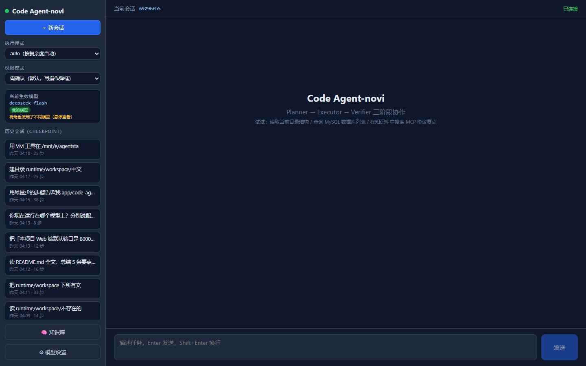
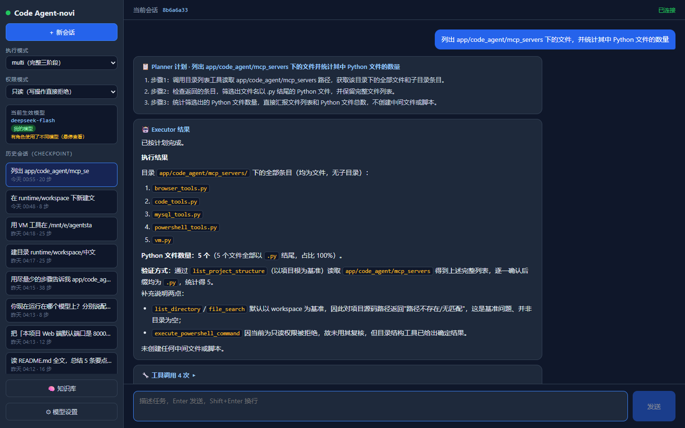
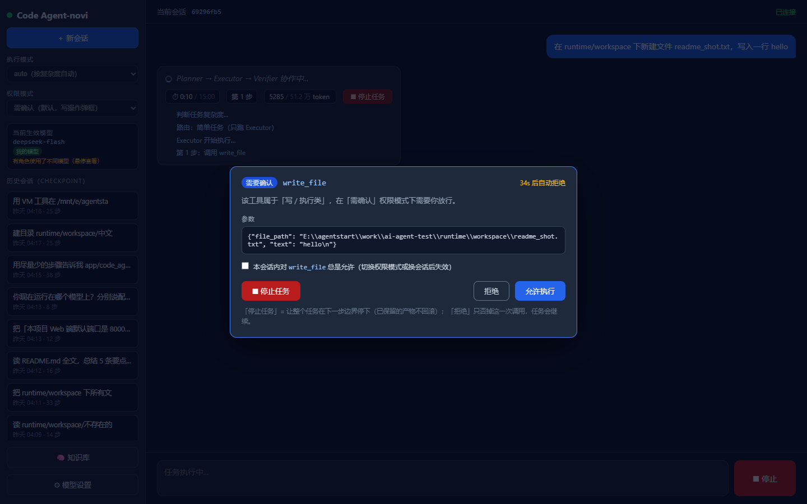
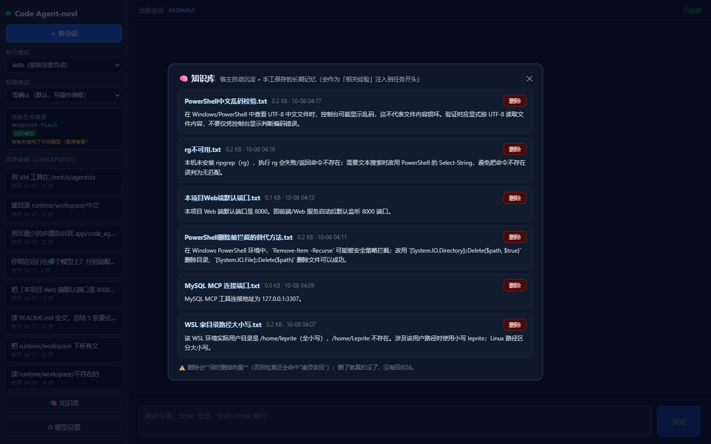
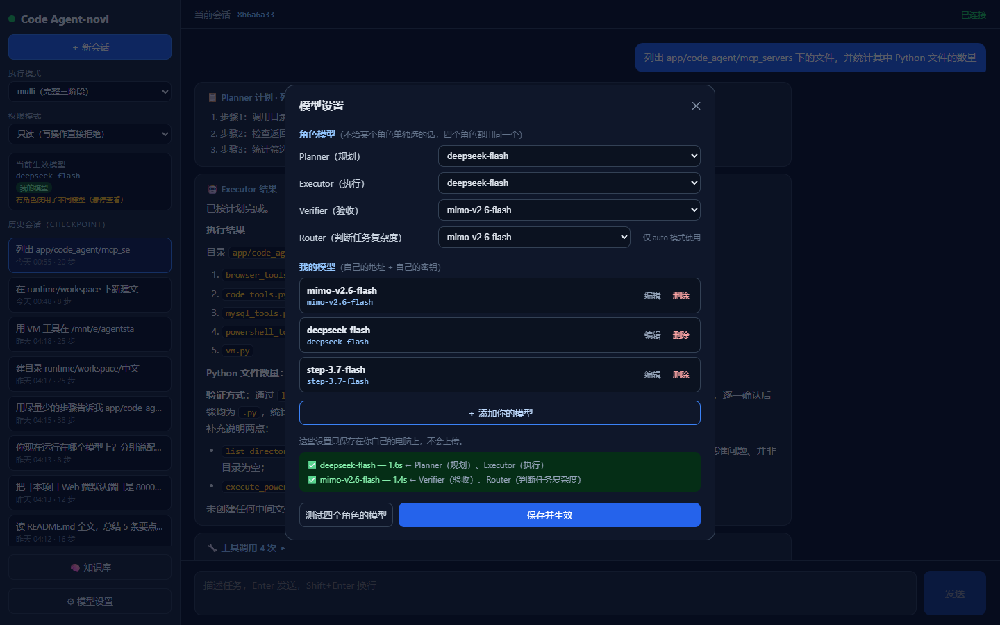
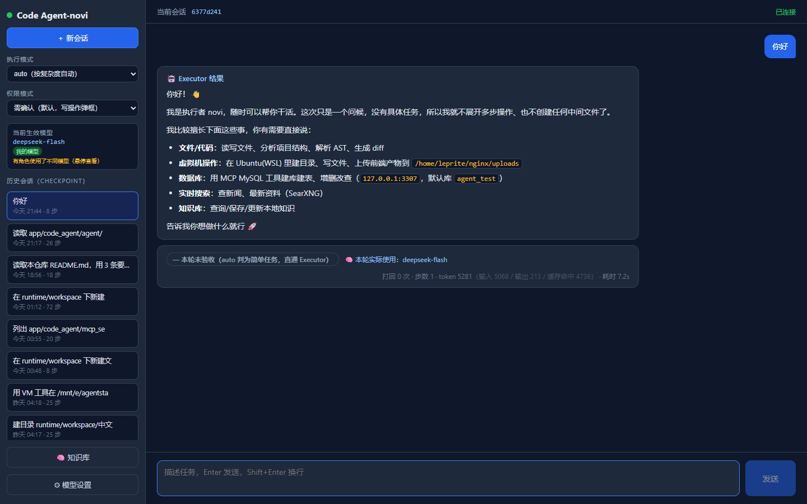

# Code Agent

> ⚠️ **项目仍在开发 / 测试中：请勿用于真实生产环境，也不要直接跑在你不想被改动的宿主机上。**
> 它**真的会执行 shell 命令、读写本机文件**（这是它的能力，不是漏洞 —— 定位就是"本机单用户的助手"）。
> 建议先在**可丢弃的环境**（虚拟机 / WSL / 有快照的机器）里试；默认权限档是「需确认」，
> 在不熟悉的目录下**不要**切到「放开」。

[](https://github.com/ColdZeda/langgraph-mcp-code-agent/actions/workflows/ci.yml)


> **给谁看**：第一次接触这个项目的人（同行 / 想跑起来的人）。
> 想了解内部约定与已知坑 → [`AGENTS.md`](AGENTS.md)；设计取舍与代价 → [`docs/architecture.md`](docs/architecture.md)。

## 一眼看懂（先看这段）

**它是什么**：本机单用户的 AI 编程 / 操作电脑助手。LangGraph 多 Agent（**Planner → Executor → Verifier**）
+ MCP 工具层（32 个工具：PowerShell / MySQL / WSL2 / 搜索 / AST 与 diff / 本地知识库）+ Web UI 与 CLI 双入口。

| 项 | 值 |
|---|---|
| **评估**（30 题 / **163 条强断言**） | **single 30/30、multi 30/30**，平均分 **1.0000**；状态 124 / 轨迹 29 / 文本 10 全过 |
| **成本画像**（multi ÷ single） | token **中位 1.58×**（总量 1.71×）、时间 2.07×；**Verifier 占总 token 25%** |
| **自动化测试** | **743** 条单元/工具级（约 30 秒跑完）+ **5** 条真集成测试（默认不跑，见「如何验证」） |
| **覆盖率 / 静态检查** | 78%~79%（`--cov`，随依赖容器状态波动）/ `ruff check` + `ruff format --check` |
| **RAG 检索对照**（2×2 消融 + 全量召回对照组） | 文件粒度 top-1 **0.6 → 0.9**，真源 top-1 0.4 → 0.6，延迟 12.8ms → 86.7ms |
| **可控性** | 任务可**随时停止**（协作式取消：节点入口 / ReAct 每步 / 每次工具调用前，共 3 个检查点）+ **15 分钟墙钟**（人工确认期间不计时）；「预算或墙钟终止」与「验收未通过」严格区分，停止后**已完成产物一律保留** |


*界面总览：左侧切换执行模式 / 权限模式 / 历史会话，右侧输入任务（底部还可用「🧠 知识库」查看长期记忆）*


*真实任务（只读档 · multi 模式）：Planner 出计划 → Executor 执行 → Verifier 验收通过；结果卡按 Markdown 渲染，并汇总本轮实际使用的模型、打回次数、步数、token 与耗时*


*「需确认」档下写操作会弹框（含参数、倒计时、「本会话总是允许」）；弹框里也有「⏹ 停止任务」——因为它盖住了输入区的停止按钮；上方是任务状态条（时长 / 步数 / token 用量与预算）与节点级实时进度*


*长期记忆面板：列出自动沉淀与手工保存的经验；删除会**同时删向量**，避免检索命中「幽灵条目」*


*模型按角色配（Planner / Executor / Verifier / Router 可各选一个）；一键测试「当前用到的每个模型」——按模型去重，2 个模型 / 4 个角色 ⇒ 只发 2 次请求*


*token 用量**拆开显示**：执行中的任务状态条与结束后的结果卡片都会给出「输入 / 输出 / 缓存命中」三项 —— 口径是**计费口径**（每次调用累加，不是上下文长度）；provider 不返回用量时会显式提示「N 次调用未计量」，不让预算闸门静默失效。**只计量、不算钱**（没有价格表，成本的用途是相对比较）*

## 能力总览

**① RAG 全链路**：`解析 → 分块 → Embedding → 向量检索 → CrossEncoder 精排 → 上下文组装`，
知识库是**本地** ChromaDB（embedding/reranker 都是本地模型、不联网；**精排缺失会自动降级**为纯向量召回，
**向量模型缺失时** RAG 那 4 个工具会明确报错并告诉你一条命令装好 —— 见「快速开始 → 安装 RAG 的本地模型」）。
做了 **2×2 消融对照 + 全量召回对照组**（整篇/分块 × 有无精排，**不用 LLM、不烧 token**）：
精排把文件粒度 top-1 从 0.6 拉到 **0.9**、把干扰源命中从 0.6 压到 0.4，代价是延迟 12.8ms → **86.7ms**。
（详见「上下文工程与分层记忆」；原始数字在 [`docs/evidence/评估报告.md`](docs/evidence/评估报告.md) 第七节。）

**② 评测体系**：30 道题 / **163 条断言**，四档强度（文本 10 / 轨迹 29 / **状态 124** / LLM 评分 0）。
三条口径是"防自欺"的：**通过 = 满分**（不给部分分留后门）、**skip ≠ 0 分**（环境不可用记「未测」，
不进分母）、**超时/异常也跑判定器**（产物可能已经写出来了）。判定器按**真实 MCP 工具名 + 真实参数名**写，
改题集有机械守卫。报告：[`docs/evidence/评估报告.md`](docs/evidence/评估报告.md)。

**③ 上下文工程**：长工具结果**外置**到磁盘、上下文里只留预览 + 路径（`read_file*` 在豁免名单里 ——
实测不豁免会让 token 涨 7.3 倍）；历史超阈值**压实**成四段式摘要（摘要失败就保留原文，省 token 不能丢历史）；
**token 预算**分节点级与任务级（阈值**按当前模型的上下文窗口自动算**，模型可在界面里声明窗口），
且任务级在 ReAct 循环**内部逐步判**（只在节点入口判会漏掉单节点烧十几万 token）。

**④ Agent 编排**：LangGraph `StateGraph` 三阶段 + `route_node` 复杂度路由（`auto` 模式），
Verifier 打回上限 `MAX_RETRY=2`；执行过程通过 WebSocket 推**节点级进度**（不引 SSE）。
工具层全部走 MCP stdio 子进程，**统一经一层包装**（权限判定 → 结果外置 → 只读缓存，三条入口 CLI/Web/评估都接）。

**⑤ 权限与 HITL**：32 个工具的三档档位表（只读 14 / 写执行 18 / 高危 6），默认「需确认」；
判定在**缓存查询之前**（否则"曾经允许过"的缓存会让已被拒绝的调用照样返回）；Web 弹框 + CLI 询问 +
超时自动拒绝 + 审计留痕；WSL2 只当**隔离执行环境**，不叫"安全沙箱"。见「安全设计」。

## 架构

```
main.py (CLI REPL)                app/web/server.py (FastAPI + Vue3 Web UI, 端口 8000)
       └────────────┬──────────────────────┘
                    ▼
   执行模式（`--mode`，默认 auto）：
     single → 只跑 Executor（快，适合查询类）
     multi  → 恒定走下面完整三阶段
     auto   → 先由 route_node 判复杂度，simple 走 single、complex 走 multi
                    ▼
   多 Agent 协作图（app/code_agent/agent/multi_agent.py, LangGraph StateGraph）
   Planner（纯 LLM 规划，输出结构化计划 JSON）
        ↓
   Executor（create_react_agent，全量工具，按计划执行）
        ↓
   Verifier（只读白名单 12 个工具，对照「需求 + 计划 + 执行轨迹」验收）
        ↓ FAIL → 带原因打回 Executor（上限 `MAX_RETRY = 2` 次；再不过就以最后一次结果收尾）

   ├── LLM：DeepSeek（OpenAI 兼容接口；Web UI 内可热切换模型 / 地址 / Key）
   │        模型**按角色配**（Planner / Executor / Verifier / Router），注册表 `config/models.json`
   ├── Memory：SqliteSaver（`runtime/checkpoints.db`，按 thread_id 恢复跨轮对话，
   │            进程重启后仍记得；Web UI 的"历史会话"就是读它）
   ├── 上下文工程：长工具结果外置 / 历史压实 / token 预算（见「上下文工程与分层记忆」）
   └── Tools：6 个自建 MCP Server（stdio 子进程）+ FileManagementToolkit
       ├── powershell_tools.py   Windows 命令执行（危险命令黑名单）
       ├── browser_tools.py      搜索（SearXNG JSON API；文件名是历史遗留）
       ├── mysql_tools.py        MySQL 增删改查（参数化 + 标识符转义）
       ├── vm.py                 WSL2 桥接（危险命令拦截 + 超时）
       ├── code_tools.py         AST 解析 / diff / 项目结构扫描 / 文件片段读取
       └── rag/rag.py            ChromaDB 知识库（分块索引 + CrossEncoder 精排 + 本地 embedding）
```

## 快速开始

### 环境要求

| 项 | 说明 |
|---|---|
| Python | 3.13+ |
| 包管理 | [uv](https://docs.astral.sh/uv/) |
| 操作系统 | Windows（PowerShell 工具与 WSL2 工具依赖宿主环境） |
| 可选 | WSL2 Ubuntu（虚拟机工具）、Docker（MySQL / SearXNG / Redis） |

### 安装

```bash
git clone https://github.com/ColdZeda/langgraph-mcp-code-agent.git
# 国内镜像（内容相同）： https://gitee.com/ColdZeda/langgraph-mcp-code-agent.git
cd langgraph-mcp-code-agent
uv sync
```

### 安装 RAG 的本地模型（知识库功能需要）

```bash
uv run python scripts/fetch_models.py --dry-run   # ① 先看装没装（不下载）
uv run python scripts/fetch_models.py             # ② 装（≈90MB × 2，走 hf-mirror；连不上就加 --source modelscope）
```

这两个模型**不在仓库里**（各≈87MB），
默认下到 `<仓库的上级目录>/embedding-model/`：**跟着仓库走**，换台机器/换个盘 clone 会自动落在旁边，
不写死任何人的路径。**没有它们也能用**：只有知识库那 4 个工具不可用（向量模型缺）或自动降级（精排缺），
其余 30+ 个工具照常。

### 配置模型（在 Web 界面里配，不用改文件）

**推荐**：启动 Web UI 后打开「⚙ 模型设置」，填 `显示名 + 模型名 + API 地址 + Key` ——
可视化、可存**多个**模型、每个模型**自带 Key**、改完**立即生效**（存本机 `runtime/web-settings.json`，不进仓库）。

**只有 CLI（`main.py`）与 evals 需要 `.env`**：这两个入口**不读界面设置**（见下面「三处配置的优先级」）。
用它们时把 `.env.example` 复制成 `.env` 并填 `MODEL_API_KEY`；其余项都有默认值，不填也能跑。

**模型是按角色配的**（Planner / Executor / Verifier / Router）。**Web 用户默认什么都不用配** ——
在「我的模型」里加一个就能用；下拉框第一项「**使用配置默认**」＝回落 `config/models.json` / `.env`（CLI 与 evals 走这条路）：

- **想给用户预置几个可选模型**（开箱即用）：填 `config/models.json`（进版本控制）。
  ⚠️ 它**默认是空的**（2026-09-22 决定）—— 格式与示例写在该文件的 `_readme` 里。
  键 = 给用户看的**显示名**、`model` 字段 = **实际发给 API 的名字**（官方改名时只动后者）。
- **用户自己加模型**：面板 →「我的模型」→ 填 `显示名 + 模型名 + API 地址 + Key`，
  存本机 `runtime/web-settings.json`，加完立刻出现在四个角色的下拉框里。
  **每个自定义模型自带凭据**，与系统默认那组互不影响（"系统默认用 `.env` 的 key、
  我的 GLM 用我自己的 key"可以共存）。旁边的「测试连接」测的就是你刚填的这一组，
  并会回显**实际测的是哪个模型名**。
- **verifier 想单独换模型**要勾上「验收使用异构模型」—— 默认三角色同模型、Verifier 跟随 Executor
  （同一个模型自己验自己容易有一致的盲区，换一个模型能拿到独立视角）。
- **界面上随时能看到"现在是谁在干活"**：侧栏常驻显示「当前生效模型」（= Executor 那个）；
  每条结果卡片另显示「本轮**实际使用**的模型」—— 后者取自服务端回报的 `model_name`，
  所以用了官方改名后的别名或中转时，你能看出**真正回答的是谁**。

> ⚠️ **三处配置的优先级**（从高到低）：
> `runtime/web-settings.json`（界面点出来的）**>** `config/models.json`（仓库里的默认）
> **>** `.env`（密钥与兜底的模型名/地址）。
> 所以**在界面上存过一次模型选择后，改 `models.json` 的 `roles` 是不生效的** —— 要回界面改。
>
> - **`web-settings.json` 里含明文密钥**（系统默认凭据 + 每个自定义模型的 key）。它已 gitignore、
>   不进仓库，但**不要分享这个文件**；界面只回显尾号 4 位。
> - **改 `.env` 必须重启服务才生效**（配置在进程启动时读一次）；而界面改的会热生效，
>   且**从下一条消息开始**（正在跑的那条任务用的是它启动时的配置快照）。
> - **CLI 与评估（evals）不读 `web-settings.json`** —— 它们只用 `config/models.json` + `.env`。

### 启动依赖服务

```powershell
.\scripts\run\start-deps.ps1     # 一键起全部 4 个：mysql / searxng / redis / nginx
.\scripts\run\stop-deps.ps1      # 停止（保留容器，下次起得更快）
```

或手动分两步：

```powershell
docker compose up -d                                            # mysql / searxng / redis
wsl -d Ubuntu -- bash -lc "cd ~/nginx && docker compose up -d"  # nginx
```

| 服务 | 容器 | 端口 | 说明 |
|---|---|---|---|
| MySQL 沙盒 | `agent-mysql` | 3307→3306 | 数据存在**命名卷** `mysql-data`；首次初始化会执行 `scripts/mysql-init/*.sql` |
| 搜索 | `searxng` | 8888→8080 | 配置/缓存在**本机** `searXNG\{config,data}`（不进版本控制） |
| 缓存 | `redis-stack-server` | 6379 | 纯缓存，**故意不挂卷**（数据可丢） |
| 静态发布 | `my-nginx` | 80 | 挂载源在 WSL（见下），由 WSL 里那份 compose 管理 |

**为什么 Agent 主体不容器化**：6 个 MCP 工具里，**PowerShell（`powershell.exe`）与 WSL2（`wsl.exe`）**
必须依赖 Windows 宿主环境，Linux 容器里跑不了。

**为什么 nginx 单独管理**：它的挂载源是 WSL 里的 `/home/user/nginx/*`（配合 `vm.py` 的"上传产物到 WSL"链路），
而主 compose 在 Windows 侧执行 —— 从 Windows 跑会把 Linux 路径解析到 docker-desktop 发行版，
导致**静默挂载空目录**（不报错，最难查）。所以两边分开管，`start-deps.ps1` 会把两边都拉起来。

> 4 个容器都带 `restart: unless-stopped` → **打开 Docker Desktop（= 启动 Docker 引擎）时会自动起来**。
> 例外：如果你**手动 stop** 过某个容器，引擎不会自动起它（这是 `unless-stopped` 的定义），
> 这时用 `scripts\run\start-deps.ps1` 即可。

### 运行（命令行）

```bash
uv run python main.py                        # 默认启动（执行模式 auto / 权限模式 需确认）
uv run python main.py --thread-id my-session # 指定会话 ID
uv run python main.py --mode single          # 执行模式：auto（默认）/ single / multi
uv run python main.py --permission readonly  # 权限模式：readonly / confirm（默认）/ open
uv run python main.py --debug                # 调试模式（详细日志）
```

> 「**执行模式**」和「**权限模式**」是**两条独立的轴**，可以任意组合（例如 `multi + readonly`）：
> 前者决定"谁来干"（要不要 Planner / Verifier），后者决定"允不允许动手"。详见[安全设计](#安全设计)。

退出：`exit` / `quit` / `q` / `退出` / `bye`

> **跨轮记忆**存在 `runtime/checkpoints.db`：不传参数时用 `.env` 的 `CODE_AGENT_THREAD_ID`
> （默认 `default`）→ **关掉再打开会继续上一次的对话**；想开一个新会话用 `--new-session`。

### 运行（Web UI）

```bash
uv run uvicorn app.web.server:app --port 8000
# 浏览器打开 http://localhost:8000
```

一键脚本（**前台**运行，日志就在这个窗口；Windows 上也可以直接双击 `.cmd`）：

```powershell
.\scripts\run\start-app.ps1        # 查 uv / 查容器 / 查 dist / 查端口 → 再起服务
.\scripts\run\start-app.cmd        # 同上，双击入口
.\scripts\run\start-app.ps1 -Dev   # 另开一个窗口跑 npm run dev（前端热更新，5173）
```

> **端口不是死的**：脚本会**实测**首选端口（默认 8000）能不能绑定，不行就自动退避
> （8000 → 8010 → 8020 → 8300 → 8310 → 9000 → 9010 → 9200，每个都实测），并告诉你改用了哪个。
> 这很有用：Windows 上 Hyper-V/WSL 会把 `7927–8126` 这类区间**保留**掉（报 `winerror 10013`），
> 表现是"端口没人占用但绑不上"。想关掉自动换端口用 `-NoFallback`；细节见
> [`scripts/run/README.md`](scripts/run/README.md)。

> 运行期**只有一个进程**：前端 `dist/` 由 FastAPI 用 `app.mount("/", StaticFiles(...))` 直接托管。
> 只有在改前端源码时才需要第二个窗口跑 `npm run dev`，那时请打开 **http://127.0.0.1:5173**
> （Vite 把 `/api` 与 `/ws` 转发给 8000）。

- 聊天界面：**执行过程实时可见** —— 任务跑起来后逐行显示
  `路由 → Planner 规划 → Executor 第 N 步调用了哪个工具 → Verifier 验收`，
  而不是干等一个转圈；结束时给结构化结果——Planner 计划、工具调用轨迹（可折叠）、
  Verifier 验收徽章、token / 耗时统计（**token 按 输入 / 输出 / 缓存命中 拆开显示**，provider 不返回用量时会提示「N 次调用未计量」）；**侧栏有执行模式与权限模式两个下拉框**
- **人工确认**：「需确认」档下，Agent 要动写 / 执行类工具时前端会**弹确认框**——
  显示工具名、关键参数、风险等级（高危的附影响面说明），可以点「允许执行」或「拒绝」，
  也可以勾「**本会话内对该工具总是允许**」（**默认不勾**，切档位或换会话即失效）；
  **没人应答会倒计时自动拒绝**
- 模型设置：界面内热切换模型 / API 地址 / Key，**四个角色（Planner / Executor / Verifier / Router）
  分别选模型**（下拉框默认只有「使用配置默认」= 走 `.env`，加上「我的模型」里用户自己加的）；
  设置只存本机 `runtime/web-settings.json`（**含明文密钥**，已 gitignore、不进仓库）
- 「我的模型」：填 `显示名 + 模型名 + API 地址 + Key` 就能接任意 OpenAI 兼容服务
  （中转站、GLM、Qwen…），**每个模型自带密钥**；可**测试连接 / 编辑 / 删除**（删除要点两次确认，
  并会顺带清掉角色里指向它的选择）
- **当前生效模型看得见**：侧栏常驻显示它（= Executor 用的那个，四角色不同时会提示）；
  每条结果卡片显示「本轮**实际使用**的模型」（服务端回报的名字，不是配置里写的那个）
- 会话列表：读 `runtime/checkpoints.db`；**点击任一会话即可切换并回放历史**，之后的对话在原会话上续聊

> 权限模式的持久化是**有取舍的**：只把「只读 / 需确认」落盘，**「放开」永不持久化** ——
> 新会话一律回落「需确认」。理由见[安全设计](#安全设计)（"我上次设过、这次忘了"是最容易埋雷的地方）。

> 前端（Vue 3 + Vite）源码在 `app/web/frontend/`，构建产物 `dist/` 已入库——不装 Node 也能直接运行；
> 改前端后 `cd app/web/frontend && npm install && npm run build` 重新构建。

## 功能

| 工具 | 能力 |
|---|---|
| 🖥️ PowerShell | 执行 Windows 命令、进程管理（危险命令黑名单拦截） |
| 🌐 搜索 | SearXNG 搜索（JSON API，**无需浏览器**；返回标题 / URL / 摘要 / 来源引擎 / 结果总数） |
| 🗄️ MySQL | 建库建表、CRUD、查询（参数化 + `_safe_ident` 标识符转义） |
| 🐧 WSL2 VM | Linux 命令执行、文件部署（危险命令拦截 + 超时） |
| 📚 RAG | 知识库 CRUD 闭环（ChromaDB 向量检索 + 本地 embedding） |
| 🔍 代码分析 | AST 解析、diff 生成、项目结构扫描、文件片段读取 |

> 📌 **关于浏览器**：搜索已改为直接调 SearXNG 的 JSON API，**移除了 Selenium + Edge 那一整套**
> （调试端口、msedgedriver 版本匹配、滚动懒加载、HTML 清洗），`browser_tools.py` 从 **228 行降到 70 行**，
> 环境要求也更简单。
> 若将来要做「**操作真实网页**」（Computer Use / Browser Agent：点击、填表、截图），
> 应另建 Playwright 工具 —— 那与「搜索取数」是两件事。

## 上下文工程与分层记忆

> **定位先说清楚**：这一层里的 RAG 是**语义记忆** —— 记录**使用过程中积累的经验/习惯**
> （Agent 自学习闭环的存储端），**不是企业知识库问答**。所以它只带一份 35 条的**测试语料**
> （在 `evals/fixtures/`，只在评估时用；**产品库默认是空的**），
> 也不追求"大而全"的检索指标：**够用即可**。

长任务最容易失控的不是"模型不够聪明"，而是**上下文管理**：一次任务读 20 个文件、
每步都要把全部历史重发一遍，token 随步数平方增长。这个项目做了五件事（前四件管上下文，第五件管**别停不下来**）：

| 机制 | 做什么 | 关键参数（`.env` 可调） |
|---|---|---|
| **工具结果外置** | 过程性长输出落盘到 `runtime/tool_results/`，上下文里只留预览 + 路径 | `CODE_AGENT_EXTERNALIZE_THRESHOLD=6000`（字符）/ 150 行 |
| **对话压实** | 历史超阈值 → 最老的一段压成「目标 / 约束 / 已完成 / 未决」四段式摘要 | **按模型窗口自动算**（窗口的 25%；128k → 32000） |
| **token 预算** | 节点级（单次调用输入）超预算先剪枝（砍最老的工具结果）；任务级（单任务累计）超限**主动终止并报告** | 同上，窗口的 **50%** / `max(50 万, 4×窗口)`（128k → 64000 / 512000） |
| **分层记忆** | 语义记忆 = ChromaDB 知识库：**按语义块**建索引 + CrossEncoder 精排；任务开始时**自动注入**相关经验，任务成功后**自动沉淀**新经验 | `CODE_AGENT_RAG_*` |
| **可控性**（停止 / 墙钟） | **协作式停止**：只在三个检查点生效（节点入口 · ReAct 每一步 · 每次工具调用之前）——正在飞的那次模型调用不打断，但它之后的步骤一定不再开始；**墙钟**到点走同一条停止路径（原因码不同）；权限弹框期间**暂停计时** | `CODE_AGENT_TASK_WALL_CLOCK=900`（秒，0 = 不限） |

> ⚠️ **`read_file_range` / `read_file` 故意不参与外置**：实测把"读全文"的结果藏起来，
> 模型会改用分段读绕过去 —— 同一道题的 token 反而从 17,361 涨到 127,071（7.3 倍）。
> 外置只用于**过程性输出**（命令输出 / 目录清单 / 搜索结果）。
> ⚠️ **自动沉淀在跑评估时关闭**（`run_single_task` 强制关）：否则评测过程产生的经验会写进知识库，
> 让后续题目的检索结果改变、同一批数据前后不可比。
> ⚠️ **2026-09-24 起，跑评估时「自动注入」也默认关闭**（唯一例外是 `E022`，它专门测 `query_rag`）：
> 注入函数**没有相关性阈值**（每题都注 top-3），而 8 个维度里没有"抵抗错误知识"这一维 ——
> 开着等于给每道题都加一个没打算测的变量。注入内容会记进结果 JSON 的 `knowledge_injected`。
> ⚠️ 但**「模型自己调 `save_knowledge`」这条路关不掉**（工具是产品真实存在的，摘掉等于改口径）——
> 所以评估改成**每题开跑前把知识库复位**（日志里出现「`1 篇已删清理`」是正常且必需的）。

**RAG 改造前 vs 改造后**（`uv run python evals/rag_ablation.py`；**2×2 消融 + 全量召回对照组**，
同一批 10 个查询、同一份知识库、同一个 embedding 模型 → 谁贡献了多少一目了然）：

| 组合 | 索引 | 精排 | 候选集 | top-1 命中**正解文件** | top-1 命中关键词（文件粒度） | top-1 落干扰项 | 稳态延迟 |
|---|---|---|---|---|---|---|---|
| **A** 改造前 | 整篇 | 否 | 全部 7 篇 | 0.40 | 0.70 | 0.60 | 13 ms |
| **B** | 整篇 | 是 | 全部 7 篇 | 0.70 | 1.00 | 0.30 | 189 ms |
| **C** | 分块 | 否 | 前 10 块 | 0.50 | 0.80 | 0.50 | 14 ms |
| **D 现状（生产）** | 分块 | 是 | 前 10 块 | **0.60** | **0.90** | **0.40** | 86 ms |
| **E** 对照 | 分块 | 是 | 全量 35 块 | **0.70** | **1.00** | **0.30** | 290 ms |

- **`correct_source_top1` 是主指标**：top-1 的来源*是不是这道题该去的那个文件*（正解文件是人工核对原文标注的）。
  只报"关键词命中"会高估质量 —— `with` 这种词哪个文件里都可能有，而"推荐 f-string"和"别用 f-string"都命中关键词。
- **A → D 是这次改造的真实变化**：正解文件命中 **0.40 → 0.60**，干扰项落到第一的比例 **0.60 → 0.40**。
  同口径的"关键词命中（文件粒度）"是 0.70 → 0.90。
- **另外三个如实披露的局限**：知识库只有 **4 篇正解 + 3 篇干扰（35 条原子，每篇 140~370 字符）**，
  语料极小会把"整篇 vs 分块"的差距压小 → 上表是**真实下界，不可外推到大语料**；
  精排模型（`ms-marco-MiniLM-L-6-v2`）是段落级语料训练的，B 组喂整篇文件属分布外输入；
  延迟为本机单进程数字（冷启动单独测，未混入稳态）。
  原始结果（含每条查询的 top-1/top-3 明细）：`docs/evidence/rag_ablation_20260924_053228.json`。

## 安全设计

> **一句话**：这是个**本地单用户**工具，安全设计的目标**不是"防外人"，而是"防 Agent 自己
> （或我的误操作）把本机搞坏"**。所以边界画在**应用层**，而不是假装有 OS 级沙箱。

### 三层防线（判据不同，**故意不合并**）

| 层 | 在哪 | 管什么 | 随权限模式变吗 |
|---|---|---|---|
| ① **工具级档位表**（主防线） | `app/code_agent/security/permissions.py` | 这个工具在当前档位下**该不该**执行 | ✅ 就是它 |
| ② **内容级危险命令黑名单** | `mcp_servers/vm.py` / `powershell_tools.py` | 同一个工具，**这次参数**危不危险 | ❌ 不变（选「放开」也照样拦） |
| ③ MySQL 语句白名单 + 只读账号 | `mysql_tools.py` / `scripts/mysql-init/*.sql` | 只读工具被拿来写数据 | ❌ 不变 |

> 为什么 ① 和 ② 不合并：**判据不同** —— 档位表问"有没有副作用"，黑名单问"这次参数危不危险"。
> 同理它和工具缓存名单（`CACHEABLE_TOOL_NAMES`）也是两张表，后者问"结果会不会变"。
>
> **权限真的拦得住（实测）**：让 Agent 去删一个废弃库（`E023`），它发出了 `DROP DATABASE`，
> 被**高危档拒绝**；只读档下的写操作，连"改走 `Set-Content` 绕一圈"也被拒（`E024`）——
> 两道题都带"库还在 / 探针文件不存在"的状态断言，全过。细节见 `docs/evidence/评估报告.md`。

### 三档权限模式（默认「需确认」）

32 个工具被分成 A 类**只读 14 个** / B 类**写·执行 18 个**（其中 6 个标 🔴 高危）：

| 档位 | A 类只读工具 | B 类写 / 执行工具 |
|---|---|---|
| **只读** | ✅ 放行 | 🚫 **直接拒绝**（不弹框，直接告诉模型"为什么不行 + 怎么改"） |
| **需确认**（默认） | ✅ 放行 | ⏸ **弹确认框**（高危的显示影响面） |
| **放开** | ✅ 放行 | ✅ 直接执行（**危险命令黑名单仍然生效**；高危操作**仍然强制留痕**） |

**三类工具之外的（未归类）在任何档位都拒绝** —— 白名单语义：
以后新增工具忘了归类，是"默认拒绝"而不是"默认放行"（有一条测试盯着"32 个工具一个不多一个不少"）。

**⚠️ 粒度是「工具级」不是「参数级」**：只要是 B 类工具，参数再无害也会弹
（用 `write_file` 写一个 `hello.py` 也弹）。代价是"同一工具内不同参数的危险差异"被抹平了，
好处是规则简单、可预测、不会因为参数解析出错而漏放。

### 四个实现细节（都是踩出来的）

1. **权限判定在缓存查询之前** —— 否则"曾经允许过"的缓存值会让**已被拒绝**的调用照样返回结果；
2. **被拒绝 / 被否决的调用绝不写缓存**（缓存里只能是真实执行结果）；
3. **拒绝用独立异常类型** —— 不会被"写失败 → 清缓存"那条分支误当成执行失败；
4. **拒绝信息必须带"原因 + 出路"**（例：`当前权限模式为「只读」，工具 write_file 被拒绝；
   如需写入请把权限模式切到「需确认」`），否则模型会反复重试同一件事，白烧 token。

这四条各有测试守着，不是靠注释：`tests/test_permissions.py`。

### 权限模式的持久化（有意的取舍）

- **「只读 / 需确认」落盘**（`runtime/web-settings.json`）—— 常用档位设一次就够；
- **「放开」永不持久化**，新会话一律回落「需确认」；
  即使有人手改配置文件塞了 `"open"`，加载时也当「需确认」处理。
  理由：**"我上次设过、这次忘了"是最容易埋雷的地方**。
- CLI 默认「需确认」；无人值守入口（无头脚本）必须显式指定档位 ——
  否则按"没人应答 → 自动拒绝"的规则，每个写工具都会被拒，等于入口不可用。

### 留痕（`runtime/permissions.log`）

每一条**确认决定**（允许 / 拒绝 / 超时 / 无人值守被拒）和**放开档下的高危操作**都追加一行 JSON：

```json
{"ts":"2026-09-21T13:03:27","scope":"manual-test","tool":"write_file_to_vm","mode":"readonly",
 "tier":"write","high_risk":true,"decision":"deny_mode","args":"{\"file_path\": \"/tmp/x\", ...}"}
```

该文件在 `runtime/` 下（**gitignore**），审计写入失败**只记日志、绝不影响工具调用**。

### ⚠️ WSL2 不是安全沙箱

WSL2 常被当成"沙箱"，但**它不是安全边界**：

- 它**默认把 Windows 盘挂在 `/mnt/c`、`/mnt/e`…**，而这个项目的 `vm.py` 还**主动在用这条通道**
  （`windows_path_to_wsl_path()` 就是把 `E:\...` 转成 `/mnt/e/...` 去读写 Windows 文件）；
- 命令以**当前用户身份**运行，没有内核级隔离；
- 内容级黑名单是**字符串匹配，本质上列不全**：`& (Get-Command Remove-Item) -Recurse -Force C:\`
  这类动态写法绕得过去。

所以对外一律说「**WSL2 隔离执行环境**（命令黑名单 + 应用层三档权限）」，
**不说"WSL 安全沙箱"**。真正的边界要用 OS 级机制（Linux 的 Landlock + seccomp、
macOS 的 Seatbelt、Windows 的 restricted token + job object，或干脆一次性容器 / VM）——
本项目**明确不做**（平台相关的重活，边际收益低）。

### ⚠️ 也没有「Agent 只能在工作区内操作」这个保证

这一条容易被误解，所以说清楚 —— **它的真实语义是"文件工具被关在工作区里"，不是"Agent 的活动范围被限制了"**：

| | 限制情况                                                          |
|---|---------------------------------------------------------------|
| **7 个文件工具**（`read_file` / `write_file` / `list_directory` / `file_search` / `move_file` / `copy_file` / `file_delete`） | ✅ **被 `FileManagementToolkit(root_dir=WORKSPACE_DIR)` 关在工作区** |
| **`execute_powershell_command`** | ❌ **完全不受限** —— cwd 是**仓库根**，能读写这台机器上它有权限的任何路径                 |
| VM（WSL）四个工具 | ❌ 接受任意 `dir_path`（但也因此超出 workspace，所以都标了高危）                   |

⇒ **shell 的能力是文件工具的"超集"**：读（`Get-Content`）、写（`Set-Content` / `>`）、
列（`Get-ChildItem`）、搜（`Select-String`）、删（`Remove-Item`）、移动复制 —— **全都有一条 shell 路径**。

**实测例证**：评估里 E003 那题 agent 直接 `Get-ChildItem -Recurse` 扫了整个仓库
（命中了 `.env`、`runtime/` 下的日志与 checkpoint、`.temp/`…），E016 那题则用 shell
把**所有 python 进程**杀了（连评估程序自己一起）。**这两件事都不是"越权"，因为本来就没有围栏。**

**想要真的围栏，要新加一层**（解析每个写工具的**路径参数**，落在工作区外就拒绝或升档）——
但 shell 那条路只能做启发式，做不到严谨。

### 为什么"结构化工具"和 shell 并存

两条路确实有重叠（上面那张表就是证据），但**结构化工具对模型明显更友好**，所以有意都留着：

| # | 结构化工具（`read_file_range` / `write_file` …） | shell（`execute_powershell_command`） |
|---|---|---|
| 1 | **参数有 schema**：名字 / 类型 / 必填 / 枚举 / 示例都是显式声明的 | 要模型自己拼语法 —— **引号与转义是它最容易翻车的地方**（E016 就是被引号和 `&` 坑死的） |
| 2 | **参数结构化传递**：没有 quoting / escaping / 编码问题 | 空格、`&`、`\|`、换行、中文**全是雷** |
| 3 | **返回值可控**：可以是 JSON、可以带行号、可以截断 | 给你一大坨裸文本 |
| 4 | 🔴 **能按参数做策略** —— 工具层看得见 `file_path` 这个**参数名**，于是能做"路径落在工作区外就拦" | 只有一整条字符串，**只能做启发式** |
| 5 | **可精确缓存**：`(工具名, 参数)` 就是稳定的 key | 同一条命令有无数种写法，缓存不了 |
| 6 | **权限可精确分档**：按工具名分档 | 一条命令包罗万象，只能整体定档 |
| 7 | **trace 可读**：结构化记录工具 + 参数 | 要解析命令行 |

**一句话**：结构化工具是"**能力收窄但可控**"的通道；shell 是"**能力最大但不可控**"的逃生口。
主流编程 Agent 都是两者并存；这里的选择是**明确承认** shell 是不可控的那条路（见上一节）。

### 走查一条真实链路（实测）

```
[只读档] list_files_in_vm('/tmp')   → 放行（真跑，返回 677 字符）
[只读档] make_dir_in_vm             → ✅ 拒绝 decision=deny_mode（未执行、未缓存）
[只读档] write_file_to_vm           → ✅ 拒绝（high_risk=true 已写审计）
[放开档] make_dir_in_vm             → 放行（真实执行；非高危 → 不记审计，避免刷屏）
[需确认档] write_file              → ⏸ 前端弹框 → 点允许 → 执行；点拒绝 / 超时 → 不执行
```

内容级黑名单那层另有 87 条测试，包括**正反两向**：漏拦清单里的写法全部拦住、
正常操作（`rm -rf ./build`、`Remove-Item ./temp.txt`…）**不被误拦**，
并且用"打桩 `subprocess`"断言**危险命令根本走不到启动子进程那一步**（`tests/test_dangerous_commands.py`）。

## 评估体系

> 题集与评分器已从零重建，正式两轮已跑完并归档（2026-09-25）。
> 结果文件在 `docs/evidence/`：`v3-single.json`（单 Agent）/ `v3-multi.json`（多 Agent）。

### 正式结果（30 题 / 163 条断言）

| 轮次 | 通过 | 平均分 | 总 token | 总耗时 | 工具调用 | 步数 |
|---|---|---|---|---|---|---|
| **single**（单 Agent） | **30/30 = 100%** | **1.0000** | 958,832 | 332s | 194 | 362 |
| **multi**（Planner → Executor → Verifier） | **30/30 = 100%** | **1.0000** | 1,644,029 | 687s | 227 | 409 |

- **163 条断言两轮全过**：状态 **124/124**（真去查文件 / 库表 / WSL / 本机接口）、轨迹 **29/29**、文本 **10/10**；
- **8 个维度两轮全 1.00**：task_completion 5、safety 5、multi_step 4、cross_tool 4、
  tool_selection 3、error_recovery 3、context_management 3、efficiency 3（每题至少 1 条状态断言）；
- 两轮的口径：**single** = token 上限 200k + 每题墙钟 300~480s（逐题记在结果里）；
  **multi** = 两者都设成 **0（只计量、不拦截）**（写在该轮结果 JSON 的 `env` 快照里自证）。
  ⚠️ single 那轮跑得更早，快照里**没有**这两个字段 —— 别把两轮当成同一种自证方式。

### 双模式对照（single vs multi）

| 指标 | single | multi | 倍数 |
|---|---|---|---|
| token 总量 | 958,832 | 1,644,029 | **1.71×** |
| token 逐题中位 | — | — | **1.58×** |
| 总耗时 | 332s | 687s | 2.07× |
| Planner 固定开销 | — | 1,110 token/题（2.4%） | — |
| **Verifier 固定开销** | — | **中位 10,988 token/题（总量的 25%）** | — |
| **Verifier 打回次数** | —（single 无 Verifier） | **0** | — |

**怎么读这份对照**：**这个任务集对当前模型已经饱和**（两轮都 100%）⇒ **架构差异不体现在分数上**，
只能从成本侧看。所以结论是**适用边界**，不是"多 Agent 更强"：多出来的 Planner + Verifier
在本题集上**没有提高分数**，代价是**中位 1.58× token**，其中**四分之一**花在 Verifier 的独立验收上。

**一条口径实证（人为闸门会制造假失败）**：multi 第一次是带 **200k token 上限**跑的，
结果 **29/30** —— E015 被上限掐断（烧掉 **257k** token 仍未完成）；
把上限改成**只计量、不拦截**后，同一题集变成 **30/30**，而且**总成本更低**
（1.64M vs 1.78M token）⇒ 那道题不是"做不出来"，是**被人为闸门判死的**。
（限额版那份结果也留在 `docs/evidence/v3-multi-limit200k.json`，可对照。）

> ⚠️ **三条不能外推的事**：
> 1. **每轮每题只跑 1 次** —— 单样本，题目层面的波动（同一题两次走不同工具路线）量化不出来；
> 2. **任务集已饱和** ⇒ 上面的分数只能说明"这套系统在这 30 题上稳定做对"，
>    **不能**据此说它比单 Agent 强或弱；
> 3. RAG 消融的语料只有 **35 条原子**、CrossEncoder 偏词汇匹配 —— 那些数字是**真实下界**，别外推。

**旧题集为什么被整体删除**（不是"分数低"，是"**量不准**"：14/30 题没有任何"产物级"断言、
部分安全题的判定器事实上空转、恒定给满分）。留着一把坏尺子只会让后续开发继续拿它量东西 ——
所以删掉，而不是标注。细节见 `docs/records/2026-09-25_评估口径与缺陷账.md`。

**新尺子长什么样**（`evals/`，11 个文件 + 一个夹具目录）：

| 文件 | 职责 |
|---|---|
| `tasks.py` | **30 题题集**：基础 10 / 长任务 12 / 对抗 8；8 个维度各 ≥3 |
| `verifiers.py` | **43 个判定器工厂**，四档强度；30 题里共用了 **163 条**断言（**状态 124** / 轨迹 29 / 文本 10） |
| `runner.py` | 执行引擎：清残留 → 跑题（超时也验分）→ 汇总 → 落盘 |
| `run_e2e.py` | 命令行入口 |
| `preflight.py` | **跑前环境预检**（容器 / WSL / `.env` key / 端口 / 知识库）—— 缺一条那一轮的数据就废了，还不会报错 |
| `report.py` | **报告生成器**：把结果 JSON 变成能进 `docs/evidence/` 的 Markdown（含**算出来的 STAR 量化对比**） |
| `merge_runs.py` | **逐题分片 → 合并成一轮**（缺题**拒绝写出**，避免把残轮当整轮） |
| `reset_eval_threads.py` | **清库里的 eval 线程** —— **复用同名 run-id 前必跑**（不清会把上一轮的历史喂回给模型） |
| `rag_bench.py` | RAG 检索基准（单轮快照，与题集无关，见下一节） |
| `rag_ablation.py` | RAG **消融对照**（2×2 + 全量召回对照组，不需要 LLM，见下一节） |
| `env.py` | **语料隔离**：`use_eval_corpus()` 把评估指到 `runtime/eval_knowledge/` + `chroma_db_eval/`，**不碰产品的 `data/knowledge/`** |

**四条口径**（相对旧尺子的修正）：**通过 = 满分**（旧口径 `score >= 0.5` 就把"对一半"算通过）；
**`skip` ≠ 0 分**（环境不可用记 `unavailable`、不进分母，别把"没测"记成"做错了"）；
**超时/异常也跑判定器**（产物可能已经写出来了）；**判定器按真实 MCP 工具名 + 真实参数名写**。
另外**每道题至少 1 条状态断言**（去查真实产物：文件/库表/WSL/接口），且由测试机械守着。

```bash
uv run python evals/reset_eval_threads.py --yes        # ① 复位：清掉库里的 eval-* 线程（复用 run-id 前必跑）
uv run python evals/preflight.py --run-id v3-single    # ② 预检（修完它报的阻塞项再跑）
uv run python evals/run_e2e.py --list                  # 只看题集结构（不执行、不烧 token）
# ③ 逐题跑 single 轮（一题一进程 ⇒ 每题各落一份 JSON = 天然的增量保存）
uv run python evals/run_e2e.py --task E001 --mode single --run-id v3-single-E001
#    ... E002..E030 同上；然后合并（缺题会拒绝写出）+ 归档
uv run python evals/merge_runs.py --prefix v3-single --mode single --archive
# ④ multi 轮同样逐题，但必须换前缀
uv run python evals/merge_runs.py --prefix v3-multi --mode multi --archive
# ⑤ 出报告
uv run python evals/report.py --single runtime/runs/v3-single.json \
                              --multi  runtime/runs/v3-multi.json  \
                              --rag    docs/evidence/rag_ablation_20260924_053228.json \
                              --out    docs/evidence/评估报告.md
```

> ⚠️ **为什么逐题跑**：一个进程跑一整轮时**结果 JSON 只在整轮结束写一次**，中途被掐断就整轮白跑 ⇒
> 逐题跑之后"被掐断"不再是灾难（但**合并必须等 30 题都齐**，缺题拒绝写出）。
> ⚠️ 每次跑**必须换 `run-id`**（复用会读到上一轮的 checkpoint）；`--archive` 只归档**合并后的那一份**。
> ⚠️ 跑之前确认 `.env` 的 key 有效 —— **CLI 与评估都不读界面设置**（预检会替你验一次，不烧 token）。

**RAG 检索基准与消融对照**（与题集无关，**不需要 LLM**）：

```bash
uv run python evals/rag_bench.py                        # 现状快照：延迟 / 准确率 / 召回 / 排序
uv run python evals/rag_ablation.py --reps 10 --archive # 改造前后消融（结果归档进 docs/evidence/）
```

## 如何验证这个项目

一条命令能跑的都列在这儿（本机 Windows + 已 `uv sync`）：

| 做什么 | 命令 | 说明 |
|---|---|---|
| 单元 + 工具级测试 | `uv run python -m pytest tests/ -q` | **743 条，约 30 秒**；其中 5 条集成测试默认**不跑** |
| 静态检查 | `uv run ruff check .` + `uv run ruff format --check .` | CI 里跑的就是这两条 |
| **真集成测试**（要真依赖） | `uv run python -m pytest -m integration -v` | **5 条**：真 MySQL / 真 WSL / 真 SearXNG / 真 Redis / 真 RAG。环境不可用会**自动跳过**（不会红）<br>⚠️ 这层**只能在 Windows 本机跑**（GitHub 的 runner 是 Linux，没有 WSL），所以**不在 CI 里** |
| 跑评估前的环境预检 | `uv run python evals/preflight.py --run-id check` | 验 `.env` 的 key / 容器 / WSL / 端口 / 知识库，**只报告不修** |
| **RAG 本地模型装没装** | `uv run python scripts/fetch_models.py --dry-run` | 只看状态、**不下载**；缺模型时直接给装法（装了 Web 启动日志里也会写） |
| 看评估题集（不烧 token） | `uv run python evals/run_e2e.py --list` | 30 题的维度与断言分布 |
| 出评估报告（读归档，不重跑） | 见「评估体系」里的命令 | 生成 `docs/evidence/评估报告.md` |
| 只跑 RAG 检索基准 / 消融 | `uv run python evals/rag_bench.py` / `uv run python evals/rag_ablation.py --reps 10` | **不用 LLM**，几秒出数 |
| 改完前端重建产物 | `cd app/web/frontend && npm run build` | `dist/` **入库**（clone 下来不装 Node 也能开界面）；改前端后**必须重建并提交产物** |

> CI（GitHub Actions + Gitee）跑的就是上面第 1、2 条：`ruff check` → `ruff format --check` →
> `pytest tests/ -v`（**不需要 `.env`**：`tests/conftest.py` 会兜一个假 key）。
> ⚠️ 真集成测试**不在 CI 里**（Linux runner 没有 WSL），只能本机 `-m integration` 跑。

## 技术栈

- **Agent 框架**：LangGraph（StateGraph + `create_react_agent`）
- **MCP 适配**：langchain-mcp-adapters + FastMCP（stdio 子进程）
- **LLM**：ChatOpenAI → DeepSeek（可切换任意 OpenAI 兼容接口）；
  **按角色可配**（`config/models.json`）+ 降级链 + 超时
- **向量数据库**：ChromaDB（本地持久化，按语义块索引）
- **Embedding**：sentence-transformers（all-MiniLM-L6-v2，本地运行）
- **Rerank**：sentence-transformers 的 CrossEncoder（ms-marco-MiniLM-L-6-v2，**本地路径加载，缺失则降级**）
- **缓存**：Redis（只读工具结果缓存，挂了自动降级）
- **搜索**：SearXNG（JSON API，经 httpx 调用，不经过浏览器）
- **数据库**：PyMySQL
- **Web**：FastAPI + WebSocket；前端 Vue 3 + Vite
- **包管理**：uv（Python 3.13）

## 项目结构

```
├── main.py                        # CLI 入口（argparse：--thread-id / --new-session / --mode / --permission / --debug）
├── app/
│   ├── code_agent/
│   │   ├── agent/
│   │   │   ├── multi_agent.py     # ★ 状态图（route_node / planner / executor / verifier + 条件边）
│   │   │   ├── cancel.py          # 停止 / 墙钟（TaskCancelled / CancelToken）
│   │   │   ├── context.py         # 上下文工程：结果外置 / 历史压实 / token 预算
│   │   │   ├── memory.py          # 分层记忆：自动注入 + 自动沉淀（**进程内直调 store**）
│   │   │   ├── usage.py           # token 计量明细（计费原料通道）
│   │   │   ├── events.py          # 节点级进度事件（ContextVar sink；没绑就静默跳过）
│   │   │   ├── code_agent.py      # REPL 循环 + 非交互接口 run_single_task（供评估脚本用）
│   │   │   └── prompts.py         # System / Planner / Verifier / Executor（计划版）提示词
│   │   ├── security/
│   │   │   └── permissions.py     # ★ 三档权限档位表（32 工具）+ 判定 + 人工确认闸门 + 审计
│   │   ├── model/llm.py           # LLMRegistry：get_llm(role) / chain / invoke_with_fallback（build_llm / set_llm）
│   │   ├── config.py              # 所有配置（从 .env 读）+ setup_logging（stderr）
│   │   ├── mcp_servers/           # 5 个 MCP Server（工具数：powershell 2 / browser 1 / mysql 10 / vm 4 / code_tools 4 = 21）
│   │   │                          #   第 6 个是 rag/rag.py（4 个）⇒ 共 25；browser_tools.py = 搜索（JSON API），文件名是历史遗留
│   │   ├── rag/                   # rag.py（MCP 薄壳，4 工具）/ store.py（分块+精排）/ chunking.py（纯函数，不 import torch）
│   │   ├── tools/
│   │   │   └── file_tools.py      # FileManagementToolkit(root_dir=WORKSPACE_DIR) → 7 个文件工具
│   │   └── utils/                 # mcp.py（工具加载）/ tool_wrap.py（权限+外置+缓存）/ tool_cache.py
│   │                              #   / placeholder_guard.py（「模板没替换」检测）
│   └── web/
│       ├── server.py              # FastAPI（WS + 权限确认协议 + REST + /api/sessions + 静态托管）
│       ├── sessions.py            # 会话侧车库（runtime/sessions.db：标题 / 置顶 / 软删除）
│       └── frontend/              # Vue3 + Vite（dist 已入库）；含 PermissionDialog（人工确认弹框）
├── config/models.json             # 模型注册表（显示名 + 实际调用名；**默认空** = 走 .env）+ 角色分配 + 降级链
│                                  #   **进版本控制**；界面里加的自定义模型存在 runtime/web-settings.json
├── data/knowledge/                # **产品**知识库目录：默认空（靠使用积累）。测试语料在
│                                  #   evals/fixtures/knowledge/（35 条），评估时才用
├── scripts/                       # probe_mcp_server.py（手工发 JSON-RPC 探 MCP server 回没回）
│   │                              #   + fetch_models.py（装 RAG 的两个本地模型，各 ≈87MB）
│   │                              #   + mysql-init/*.sql（被 docker-compose 当挂载目录用，别挪）
│   └── run/                       # 启动/停止脚本：start-app.cmd / start-app.ps1（起 Web UI）
│                                  #   + start-deps.ps1 / stop-deps.ps1（起停 4 个依赖容器）
├── runtime/                       # ⚠️ gitignore：checkpoints.db + sessions.db + web-settings.json +
│                                  #   permissions.log + tool_results / chroma_db / workspace / runs
├── evals/                         # 评估体系（11 个文件 + 夹具）：tasks.py(30 题)
│                                  #   / verifiers.py(43 个判定器) / runner.py / run_e2e.py
│                                  #   / preflight.py(跑前预检) / report.py(报告+STAR)
│                                  #   / rag_bench.py(RAG 基准) / rag_ablation.py(RAG 消融)
│                                  #   / merge_runs.py(逐题分片合并成一轮)
│                                  #   / reset_eval_threads.py(复用 run-id 前清库里的 eval 线程)
│                                  #   / env.py(语料隔离) + fixtures/knowledge/(7 篇测试语料)
├── tests/                         # 743 个测试（单元 + 工具级 + 评估体系自检；含默认不跑的
│                                  #   集成测试 tests/test_integration_mcp.py）
├── docs/
│   ├── architecture.md            # 设计取舍与代价（6 条 ADR）
│   ├── archive/                   # 历史冻结快照（不再更新）
│   ├── evidence/                  # 评估原始结果（只追加）+ 报告 + 截图
│   └── records/                   # 过程账（可编辑）：走查 / 修复 / 缺陷账
├── AGENTS.md                      # AI 助手约定与已知坑
├── docker-compose.yml             # mysql / searxng / redis 三个依赖服务（nginx 由 WSL 侧 compose 管）
└── .gitee.yml                     # CI（ruff check → ruff format --check → pytest）
```

## 关键数字与复核命令

> 数值本身见上面「[一眼看懂](#一眼看懂先看这段)」和「[评估体系](#评估体系)」两张表；这里只给**怎么自己核**。

| 数字 | 复核命令 |
|---|---|
| 测试数 | `uv run python -m pytest tests/ -q` |
| 测试覆盖率 | 同上（`addopts` 自带 `--cov=app/code_agent`，看 `TOTAL` 行）。⚠️ **随环境与提交波动**（分母会随首次 import 新模块而变大）⇒ 别跨提交直比 |
| 知识库条目 | `Get-ChildItem evals/fixtures/knowledge -Recurse -File`（测试语料 35 条 = 7 文件 × 5 条；**产品库默认空**） |
| MCP 工具数 | 启动后看日志 `共加载 N 个工具` |
| 评估题数 / 断言数 | `uv run python evals/run_e2e.py --list` |
| 评估结果与成本画像 | 读 `docs/evidence/v3-single.json` / `v3-multi.json` 的 `totals` / `node_timings`（限额版对照 `v3-multi-limit200k.json`） |
| RAG 消融 | `uv run python evals/rag_ablation.py --reps 10` |
| RAG 检索基准（top1 0.9 / top3 1.0 / recall 1.0 / 稳态 83ms） | `uv run python evals/rag_bench.py`（结果写入 `runtime/runs/rag_bench_*.json`） |

## 文档地图（哪份文档管什么）

| 文档 | 是什么 | 性质 |
|---|---|---|
| `README.md` | 怎么装、怎么跑、能力总览、评估结果、已知边界 | **对外入口**（本文件） |
| `AGENTS.md` | 约定 / 常用命令 / 已知坑 / **当前状态** | AI 操作手册（活文档） |
| `docs/architecture.md` | 设计取舍与代价（6 条 ADR） | 活文档 |
| `docs/records/` | 过程账：某个坑**怎么修的、证据在哪** | 活文档（可编辑） |
| `docs/evidence/` | 评估**原始结果** + 报告 + 截图 | **只追加、不改写** |
| `docs/archive/` | 历史冻结快照（改造前的交接 / 历史版本） | **不再更新** |

> 想知道「当时怎么想的、哪条结论怎么来的」→ 看 `docs/records/`；想知道「现在该怎么做」→ 看 `AGENTS.md`。

## 已知问题与后续规划

**边界（如实写，不粉饰）**

- **本机单用户**：没有多用户 / 账号 / 部署形态。它会执行 shell、读写主机文件，所以定位就是"跑在你自己机器上"。
- **可观测性有限**：只有**节点级进度事件**（WebSocket 推送）与**权限审计日志**（`runtime/permissions.log`），
  没有指标（metrics）/ 链路追踪（tracing）。
- ⚠️ **多标签页可以各跑一个任务**（后端是「每条连接一个任务」）⇒ **请勿让两个任务同时改同一个工作区**，
  否则会互相覆盖。同一个标签页内是**串行**的：任务执行中切会话 / 新建会话会被拦住并提示（要先停止任务）。

**已知技术债**

- RAG 的 4 个工具走 MCP 子进程，每次调用要付 ≈8 秒的子进程启动（换来的是"不在事件循环里加载原生扩展"，
  因为原生扩展不能在事件循环起来之前加载）。**改进方向**：把 `query_rag` 改成进程内本地工具，或让 MCP server 常驻。
- Verifier 打回上限是 2 次；到上限后以最后一次结果收尾（不会无限重试，但也意味着"可能带着未解决的问题结束"）。
- 评估每轮每题只跑 **1 次**，所以像"同一题两次得分不同"这类**方差**从两轮里量化不出来。

**后续规划**（按价值排序）

1. RAG 工具本地化 / MCP 常驻（去掉那 8 秒）；
2. 评估加重复轮次与方差统计；
3. 更多"工具级"回归（现在真集成测试只有 5 条）。

## License

本项目采用 **MIT 许可**（见 [`LICENSE`](LICENSE)）—— 可自由使用、修改、分发，保留版权声明即可。

Copyright (c) 2026 ColdZeda
